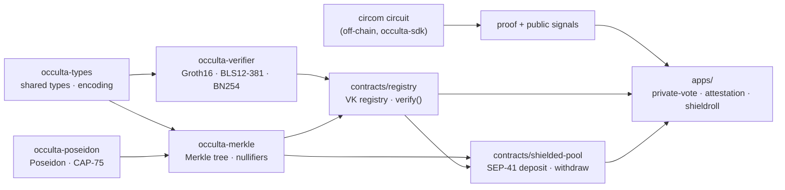

# occulta-contracts

> ⚠️ **Testnet only. Unaudited. Not for real assets.**

Occulta is a zero-knowledge toolkit for Stellar smart contracts. This repository is the
on-chain layer — a set of reusable, composable building blocks so any Soroban developer can
add ZK features to a contract without writing pairing math or porting Poseidon by hand.

---

## What it does

**Prove things on-chain without revealing the underlying data.**

A user generates a proof off-chain (using `occulta-sdk`) that they know something — a
secret note, a credential, a salary — then submits that proof to a Soroban contract. The
contract verifies the proof on-chain and acts on it: releasing tokens, recording a vote,
issuing an attestation. The underlying secret never touches the chain.

This repo provides three layers that make that possible:

### Cryptographic primitives

**Groth16 proof verification** over BLS12-381 and BN254, using Stellar's native pairing host
functions (CAP-59 / CAP-74). Submit a proof, get a boolean back. One pairing check per
transaction, no math in your contract.

**Poseidon hashing** built on CAP-75's native permutation host function, with parameters
sourced directly from circomlib. The same hash your circuit uses, available on-chain, so
Merkle paths computed off-chain verify correctly on-chain.

### Shielded state

An **incremental Merkle tree** with a root history buffer, so deposits and withdrawals can
happen concurrently without proofs going stale. A persistent **nullifier registry** that
makes double-spending impossible — a nullifier once spent stays spent, forever.

### Deployable contracts

A **verification-key registry** that any app on the network can share. Register your
circuit's VK once; every contract that needs it calls `verify()` against the registry
instead of bundling its own verifier. VKs can be frozen — once frozen, no admin can change
them, which is what trustlessness actually requires.

A **shielded pool** for SEP-41 tokens: deposit with a commitment, withdraw with a proof.
The pool enforces the correct ordering — root check, nullifier check, proof verify, nullifier
spent, then transfer — so reentrancy and double-spend are structurally impossible.

### Reference applications

- **private-vote** — anonymous, one-vote-per-member polling. Members prove membership
  without revealing who they are. Each poll is domain-separated so a vote in one poll can't
  be replayed in another.

- **attestation** — reusable KYC credentials. An anchor issues a credential commitment;
  the holder later proves they hold a valid credential satisfying some predicate, without
  revealing which credential or which issuer.

- **shieldroll** — confidential payroll. An employer deposits a total; employees each
  withdraw their own amount. The circuit proves the parts sum to the whole without revealing
  any individual salary.

---

## Architecture

---

## Protocol requirements

| Feature | CAP | Minimum protocol |
| --- | --- | --- |
| BLS12-381 pairing (`env.crypto().bls12_381()`) | CAP-59 | Protocol 22+ |
| BN254 pairing (`env.crypto().bn254()`) | CAP-74 | Protocol 25+ |
| Poseidon / Poseidon2 (`env.crypto_hazmat()`) | CAP-75 | Protocol 25+ |

Bindings verified against `soroban-sdk = "26.1.1"` — see `docs/PLATFORM.md`.

---

## Deployed testnet contracts

| Contract | Network | Contract ID |
| --- | --- | --- |
| `occulta-contract-registry` | Testnet | — |
| `occulta-contract-shielded-pool` | Testnet | — |

---

## Contributing

See `CONTRIBUTING.md`. The non-negotiable rule: no cryptographic change is merged without a
fixture proving it matches the reference implementation.

Issue templates are in `.github/ISSUE_TEMPLATE/`. Security issues: see `SECURITY.md`.

## License

Apache-2.0 — see `LICENSE`.

---

*This is independent software, not affiliated with, sponsored, or endorsed by the Stellar
Development Foundation.*
