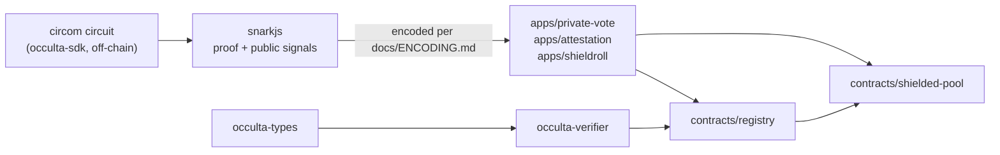

# occulta-contracts

The on-chain layer of Occulta — reusable Groth16 verification, Poseidon hashing, and
shielded-state building blocks for Stellar smart contracts, so a Soroban developer can add
zero-knowledge features without writing pairing math or porting Poseidon by hand.

> ⚠️ **Testnet only. Unaudited. Not for real assets.** Nothing in this repository has been
> security-audited, and it is not fit for holding value on mainnet. See `docs/SECURITY-MODEL.md`
> and `SECURITY.md`.

## Status

This repo is at milestone **M1 (Foundation)** of the build plan in `docs/PLATFORM.md`:
workspace, CI, and `occulta-types` (shared types + the snarkjs↔Soroban encoding rules) are
real and tested. Every other crate — `occulta-poseidon`, `occulta-verifier`,
`occulta-merkle`, both contracts, and all three reference apps — is a scaffold: it compiles,
it's in the workspace, and its module doc explains exactly what's missing and which milestone
closes the gap. **Nothing here verifies a real proof yet.** If you're looking for a
zero-knowledge feature to actually use today, this isn't it yet — track the milestones below.

## 60-second quickstart (what's real today)

There's no on-chain proof verification to demo yet (that's M3). What you *can* verify in 60
seconds is the one piece of real, tested logic in this repo — the snarkjs↔Soroban byte
encoding rules (`docs/ENCODING.md`), including the "G2 coordinate order trap" that this repo
confirmed is real by reading the actual SDK source (see `docs/PLATFORM.md`):

```sh
git clone <this repo>
cd occulta-contracts
cargo test -p occulta-types
# -> 21 tests, all green: scalar range checks, point-length validation,
#    and the G2 c0/c1 coordinate swap round-trip.
```

On Windows with Git Bash specifically, see the linker note in `CONTRIBUTING.md` if this
fails with a confusing "extra operand" error — it's a `PATH` shadowing issue, not a code bug.

## Architecture



Full diagram and the reasoning behind separating verification from app state:
`docs/ARCHITECTURE.md`.

## Deployed testnet contract IDs

None yet. `contracts/registry` is scaffolded but not implemented (M5); this table will be
filled in and kept current once something real is deployed via `scripts/deploy-testnet.sh`.

| Contract | Network | Contract ID |
| --- | --- | --- |
| — | — | — |

## Protocol requirements

- BLS12-381 curve operations (`env.crypto().bls12_381()`): CAP-59, **Protocol 22+**.
- BN254 curve operations (`env.crypto().bn254()`) and Poseidon/Poseidon2
  (`env.crypto_hazmat().poseidon_permutation()`, requires the `hazmat-crypto` feature on
  `soroban-sdk`): CAP-74 and CAP-75 respectively, **Protocol 25+**.

Verified against `soroban-sdk = "26.1.1"` by reading the crate's actual vendored source, not
assumed from documentation summaries — see `docs/PLATFORM.md` for the method and citations.

## Contributing

See `CONTRIBUTING.md` — in particular, the non-negotiable rule that **no cryptographic
change is merged without a fixture proving it matches the reference implementation**. Issue
templates: `.github/ISSUE_TEMPLATE/`.

## Non-goals

No new cryptography, no mainnet claims, no proof generation (that's `occulta-sdk`), no
indexer/relayer/HTTP service, no frontend. See the build spec this repo implements for the
full list.

---

*This is independent software, not affiliated with, sponsored, or endorsed by the Stellar
Development Foundation.*
