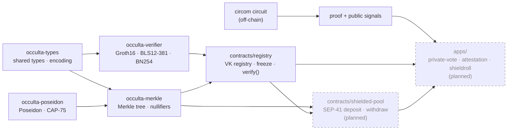

# occulta-contracts

> ⚠️ **Testnet only. Unaudited. Not for real assets.**

## Status

| Component | State |
| --- | --- |
| `occulta-poseidon` — Poseidon over CAP-75 | Implemented · 16 tests · circomlib fixtures |
| `occulta-types` — encoding, shared types, snarkjs JSON conversion | Implemented · 27 tests |
| `occulta-merkle` — tree, roots, nullifiers | Implemented · 15 tests |
| `occulta-verifier` — Groth16 BLS12-381 / BN254 | Implemented · 18 tests · BN254 verifies a real circom/snarkjs proof (`fixtures/vote/`); BLS12-381 has structural tests only |
| `contracts/registry` — VK registry with freeze | Implemented · 25 tests · verifies the snarkjs fixture · not deployed |
| `contracts/shielded-pool` | Scaffold — not implemented |
| `apps/private-vote` · `attestation` · `shieldroll` | Scaffold — not implemented |

"Scaffold" means the directory contains a placeholder crate of about ten lines and no tests.
Nothing in this repository is deployed.

---

Occulta is a zero-knowledge toolkit for Stellar smart contracts. This repository is the
on-chain layer: reusable building blocks so a Soroban developer can add ZK features to a
contract without writing pairing math or porting Poseidon by hand.

---

## What it does

**Prove things on-chain without revealing the underlying data.**

A user generates a proof off-chain that they know something — a secret note, a credential,
a salary — then submits that proof to a Soroban contract. The contract verifies the proof
on-chain and acts on it. The underlying secret never touches the chain.

### Implemented: cryptographic primitives

**Groth16 proof verification** over BLS12-381 and BN254, using Stellar's native pairing host
functions (CAP-59 / CAP-74). One `pairing_check` call per verification, `vk_x` computed with
`g1_msm`. On BN254, a real circom/snarkjs proof verifies on the Soroban host for about 27M
CPU instructions (`docs/BUDGET.md`). No BLS12-381 proof fixture exists yet.

**Poseidon hashing** built on CAP-75's native permutation host function, with parameters
generated from circomlib (`scripts/poseidon-gen/`) and checked against circomlibjs output.

### Implemented: shielded-state primitives

An **incremental Merkle tree** with a root history buffer, so concurrent deposits do not make
in-flight proofs stale, and a persistent **nullifier set**: a nullifier once spent stays spent.

### Implemented: verification-key registry

`contracts/registry` stores Groth16 VKs by circuit id (`Symbol`) so other contracts can call
`verify(circuit_id, proof, public_signals)` instead of bundling a VK. The admin can register
or replace a circuit's VK until the circuit is frozen. `freeze` is one-way: after it, the
VK cannot change, even at the admin's request. While a circuit is unfrozen, whoever holds
the admin key can swap in a VK that accepts forged proofs, so rely only on frozen circuits
(`is_frozen`). `verify` is read-only. Storage is `persistent()`, and anyone can call
`extend_ttl`.

| Function | Auth | Notes |
| --- | --- | --- |
| `__constructor(admin)` | — | sets the admin |
| `register(circuit_id, vk)` | admin | fails with `CircuitFrozen` once frozen |
| `freeze(circuit_id)` | admin | one-way |
| `set_admin(new_admin)` | admin | |
| `get_vk(circuit_id)` / `is_frozen(circuit_id)` / `admin()` | — | reads |
| `verify(circuit_id, proof, public_signals)` | — | `Ok(true)` / `Ok(false)` / error; off-curve points abort the call |
| `extend_ttl(circuit_id)` | — | renews storage TTL |

### Planned (not implemented)

The following are design intent only. Their directories are scaffolds.
- **Shielded pool** (`contracts/shielded-pool`) — a SEP-41 deposit/withdraw pool that will
  enforce root check → nullifier check → proof verify → nullifier spent → transfer, in that
  order.
- **private-vote** — anonymous one-vote-per-member polling, domain-separated per poll.
- **attestation** — reusable credentials proved against a predicate without revealing the
  credential or issuer.
- **shieldroll** — confidential payroll where the circuit proves the parts sum to the whole.

---

## Architecture

Solid nodes are implemented crates. Dashed nodes are scaffolds (planned, not implemented).

---

## Protocol requirements

| Feature | CAP | Minimum protocol |
| --- | --- | --- |
| BLS12-381 pairing (`env.crypto().bls12_381()`) | CAP-59 | Protocol 22+ |
| BN254 pairing (`env.crypto().bn254()`) | CAP-74 | Protocol 25+ |
| Poseidon / Poseidon2 (`env.crypto_hazmat()`) | CAP-75 | Protocol 25+ |

Bindings verified against `soroban-sdk = "26.1.1"` — see `docs/PLATFORM.md`.

---

## Deployed testnet contracts

None. No contract in this repository is deployed yet.

---

## Contributing

See `CONTRIBUTING.md`. The non-negotiable rule: no cryptographic change is merged without a
fixture proving it matches the reference implementation.

Issue templates are in `.github/ISSUE_TEMPLATE/`. Security issues: see `SECURITY.md`.

## License

Apache-2.0 — see `LICENSE`.

---

*This is independent software, not affiliated with, sponsored, or endorsed by the Stellar
Development Foundation.*
