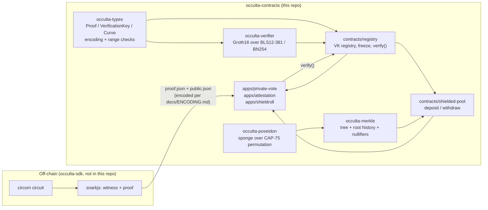

# Architecture

## Crate dependency order (build/verification order too — see milestones)

`occulta-types` → `occulta-poseidon` / `occulta-verifier` → `occulta-merkle` →
`contracts/registry` → `contracts/shielded-pool` → `apps/*`.

Each arrow is also a trust boundary: a bug in `occulta-types`' encoding rules propagates to
every crate downstream, which is why it's the only crate with real, tested logic as of this
writing (M1). See `docs/PLATFORM.md` for the verified SDK bindings each crate is built
against, and the per-crate module docs (`crates/*/src/lib.rs`) for exactly what is and isn't
implemented yet.

## Why verification is separate from state (registry vs. app contracts)

One reviewed `occulta-verifier` implementation, deployed once as `contracts/registry`, serves
every app on the network. A VK update in the registry never touches an app's own storage
(deposits, nullifiers, Merkle tree) — those live in the app or pool contract, not the
registry. This also makes `freeze` meaningful: an app that needs real trustlessness points at
a *frozen* circuit in the registry, so no admin key — not even the registry's own — can later
swap the verification key out from under it (Security Invariant #7, `docs/SECURITY-MODEL.md`).
