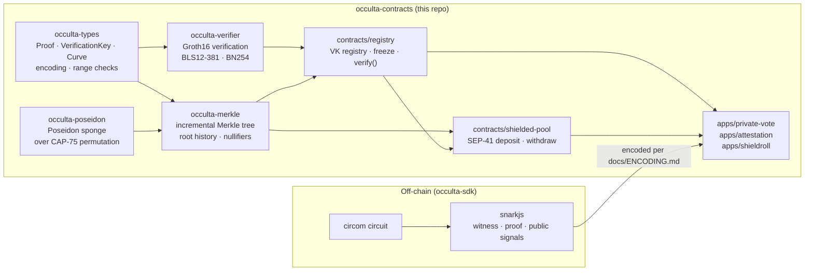

# Architecture



---

## Crate dependency order

```
occulta-types
    ├── occulta-poseidon
    ├── occulta-verifier
    └── occulta-merkle (also depends on occulta-poseidon)
            └── contracts/registry (also depends on occulta-verifier)
                    └── contracts/shielded-pool
                            └── apps/*
```

Each layer only depends on layers below it. `occulta-types` has no internal dependencies —
it is the shared vocabulary the entire stack speaks.

---

## Why verification is separated from state

One deployed `contracts/registry` serves every app on the network. Apps call
`registry.verify(circuit, proof, signals)` rather than bundling their own verifier. This
means:

- A single reviewed verifier implementation covers all apps.
- A VK update in the registry never touches an app's own storage (its Merkle tree,
  nullifiers, or balances live in the app or pool contract).
- `freeze` is meaningful: an app that requires real trustlessness calls
  `registry.freeze(circuit)` once. After that, no admin — including the registry's own —
  can swap the VK. An unfrozen circuit gives the registry admin the ability to mint arbitrary
  proofs; a frozen one does not. See Security Invariant #7 in `docs/SECURITY-MODEL.md`.

---

## Shielded pool withdraw ordering

`contracts/shielded-pool::withdraw` enforces a strict five-step sequence that cannot be
reordered:

1. `Tree::is_known_root(root)` — reject stale roots
2. `!Nullifiers::is_spent(nullifier)` — reject replays
3. `registry.verify(circuit, proof, signals)` — cryptographic check
4. `Nullifiers::spend(nullifier)` — mark spent (effect)
5. Token transfer to recipient and relayer (interaction)

Steps 4 and 5 must be in this order. The token transfer is a cross-contract call. Marking
the nullifier spent *after* a cross-contract call is a reentrancy hole. See Security
Invariant #3 in `docs/SECURITY-MODEL.md`.

---

## Public signal ordering

The `public_signals` vector passed to `registry.verify` must match the circuit's signal
declaration order exactly: output signals first, then public input signals, each in
declaration order. A silently reordered signal is a critical vulnerability — it lets a
caller bind a proof to a different statement than the circuit encodes, with no compiler
warning. Each app contract documents its own signal table in its README and enforces it with
a test that swaps two signals and asserts verification fails.

---

## Poseidon parameter sourcing

`occulta-poseidon` does not embed the host's own parameter tables. It sources constants from
two independent references:

- **BN254:** extracted mechanically from the `circomlibjs` npm package (iden3's own JS
  reference implementation of circomlib) via `scripts/poseidon-gen/gen.mjs`. Circomlib's
  BN254 `t=3` uses `rounds_p=57`; SDF's own host test vectors use `rounds_p=56`. These are
  incompatible. Occulta uses circomlib's value so circuits written against circomlib verify
  correctly on-chain.
- **BLS12-381:** extracted from `soroban-env-host 26.1.4`'s own CAP-75 conformance vectors
  via `scripts/poseidon-gen/extract_bls.mjs`. circomlib has no native BLS12-381 parameters.

Every parameter set is verified by a differential test in `crates/occulta-poseidon/src/tests.rs`
against committed fixtures in `fixtures/poseidon/`. See `scripts/poseidon-gen/README.md` for
exact provenance and reproduction instructions.
